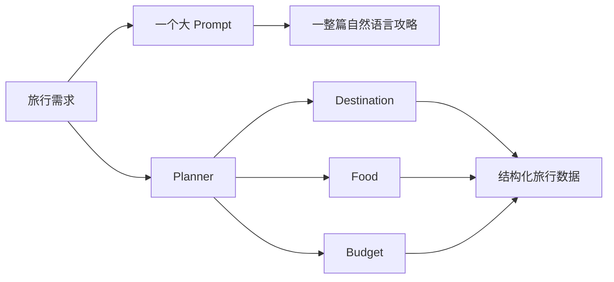

## 从一个 Prompt 开始

我最开始想做 Voyager-AI 时，第一反应很直接：写一个 Prompt，把目的地、天数、预算和兴趣交给大模型，让它生成一份旅行计划。

Prompt 就是我们交给模型的要求和背景资料。这里说的大模型，也就是常见的 LLM（Large Language Model），例如 GPT 或本地运行的 Qwen。

如果只是做个演示，这个方案完全可行。代码甚至不需要多少行：

```python
prompt = f"""
请帮我制定一份旅行计划。

目的地：杭州
天数：3 天
人数：2 人
预算：1200 元
兴趣：茶文化、历史

请给出景点、美食、预算和注意事项。
"""

answer = model.invoke(prompt)
print(answer.content)
```

代码中的 `model.invoke(prompt)`，可以直接理解成“把这份要求发给模型，然后等待回答”。

## 生成了答案，程序却接不住

模型通常能返回一篇看起来不错的攻略。问题是，程序除了把它显示出来，几乎什么也做不了。

预算有没有超过 1200 元？餐饮和住宿分别花了多少？景点信息缺失时应该只补景点，还是整篇重新生成？如果模型前半段说“预算充足”，后半段的明细却加起来超支，程序又该相信哪一段？

这些问题让我意识到：**一段完整的自然语言答案，适合人阅读，却不一定适合程序继续处理。**

这也是 Voyager-AI 开始拆分 Agent 的原因。



上半条路线把所有要求一次性交给模型；下半条路线把任务拆开，让每部分返回程序可以分别检查的数据。

## 先用普通 Python 拆开任务

“Agent”这个词很容易让人想到几个 AI 在会议室里互相讨论。实际写代码时，可以先把它理解成一个更普通的东西：

> 一个只负责某项任务的处理单元。它读取已有数据，完成自己的工作，再返回一小部分新数据。

例如，旅行规划可以先拆成几个普通 Python 函数：

```python
def plan_destination(request: dict) -> dict:
    return {
        "destination_info": {
            "name": request["destination"],
            "focus": request["interests"],
        }
    }


def plan_food(request: dict) -> dict:
    return {
        "foods": [
            {
                "name": f"{request['destination']}本地风味",
                "category": "local",
            }
        ]
    }


def plan_budget(request: dict) -> dict:
    total = int(request["budget"] * 100)
    return {
        "budget": {
            "total_minor": total,
            "categories": [
                {"category": "transport", "amount_minor": int(total * 0.3)},
                {"category": "lodging", "amount_minor": int(total * 0.35)},
            ],
        }
    }
```

这里还没有 LangChain，也没有 LangGraph。但分工已经出现了：目的地函数只返回 `destination_info`，美食函数只返回 `foods`，预算函数只返回 `budget`。

相比“一次生成整篇攻略”，这种做法多了几个好处：

- 预算可以单独测试，不用比较整篇文案；
- 美食生成失败时，不必重新生成目的地信息；
- 每一部分都能使用不同的数据结构；
- 后面可以让互不依赖的任务同时执行。

所以，多 Agent 的第一步并不是安装框架，而是先判断问题能不能拆成职责清楚的小任务。

## Voyager-AI 的六个 Agent

项目现在有六个 Agent：

| Agent | 负责什么 | 主要返回字段 |
| --- | --- | --- |
| Planner | 决定本轮需要完成哪些任务 | `tasks` |
| Destination | 整理目的地信息 | `destination_info` |
| Food | 整理餐饮建议 | `foods` |
| Budget | 分配旅行预算 | `budget` |
| Reviewer | 检查结果是否完整 | `review_status`、`risks` |
| Final | 把已有数据整理成最终方案 | `final_plan` |

这些 Agent 并不是六个不同的大模型。它们可以共用同一个模型，也可以完全不调用模型。在这个项目里，Agent 指的是一个职责明确的处理单元：读取当前旅行数据，必要时调用模型，再交回自己负责的结果。

## 一个 Agent 是怎样实现的

比如当前项目的 `BudgetAgent` 在默认模式下使用普通 Python 计算：

```python
class BudgetAgent(_TravelAgent):
    prompt_key = "budget"

    def _execute(self, state: TravelState) -> dict[str, object]:
        if self.model is not None:
            result = self._invoke_model(state, _BudgetResult)
            return {"budget": result.model_dump()}

        total_minor = int(
            (
                Decimal(str(state["user_request"]["budget"]))
                * 100
            ).quantize(Decimal(1))
        )

        # 按比例计算交通、住宿、餐饮等预算
        # 最后用总额减去已分配金额，避免取整后对不上账
        ...

        return {
            "budget": {
                "total_minor": total_minor,
                "categories": categories,
            }
        }
```

先看最重要的分支：

```python
if self.model is not None:
```

有模型时，BudgetAgent 请求模型生成 `_BudgetResult`；没有模型时，就走下面的确定性计算。所谓“确定性”，就是相同输入一定得到相同结果，不依赖网络，也不会因为模型状态不同而变化。

这样设计以后，工作流和测试不必绑定某个模型。先用确定性逻辑确认数据能正确流动，再换成 Ollama 或 OpenAI 兼容模型，出了问题也更容易判断是工作流错了，还是模型输出不符合要求。

## LangChain 在这里做了什么

LangChain 是一套开发大模型应用的工具库。Voyager-AI 并没有大量使用传统的 `LLMChain`，而是把 LangChain 当成一层统一的模型接口。

项目支持两种模型实现：

```python
from langchain_ollama import ChatOllama
from langchain_openai import ChatOpenAI
```

本地运行可以使用 Ollama：

```python
ChatOllama(
    model="qwen3.5:9b",
    base_url="http://localhost:11434",
    temperature=0,
)
```

OpenAI 或兼容接口则使用：

```python
ChatOpenAI(
    model=settings.model,
    base_url=settings.base_url,
    api_key=settings.api_key,
    temperature=settings.temperature,
)
```

上层 Agent 不需要分别学习两套 SDK。只要拿到的对象符合 LangChain 的 ChatModel 接口，就可以用相同方式调用。

更关键的是结构化输出（Structured Output）。普通模型回答是一段文字，结构化输出则要求模型按照规定字段交回数据：

```python
def invoke_structured(model, schema, payload, *, prompt=None):
    model_input = prompt or json.dumps(payload, ensure_ascii=False)

    runnable = model.with_structured_output(schema)
    result = runnable.invoke(model_input)

    return schema.model_validate(result)
```

这里的 `schema` 可以理解成数据填写规则：它规定有哪些字段、字段是什么类型。项目使用 Pydantic 编写这份规则；Pydantic 是 Python 中常见的数据校验库。例如 BudgetAgent 使用的结构可以简化成：

```python
class BudgetCategory(BaseModel):
    category: str
    amount_minor: int


class BudgetResult(BaseModel):
    total_minor: int
    categories: list[BudgetCategory]
```

调用 `with_structured_output(BudgetResult)` 后，我们期待的就不再是一篇随意发挥的预算说明，而是一份字段明确的数据：

```json
{
  "total_minor": 120000,
  "categories": [
    {"category": "transport", "amount_minor": 36000},
    {"category": "lodging", "amount_minor": 42000},
    {"category": "food", "amount_minor": 24000},
    {"category": "activities", "amount_minor": 18000}
  ]
}
```

程序现在可以把分类金额加起来，检查是否等于 120000；也可以把预算单独显示在前端。自然语言仍然有价值，但它不再是程序唯一能拿到的结果。

## 什么时候值得拆成 Agent

如果两个步骤总是使用完全相同的输入、一起执行、一起失败，也没有独立测试的必要，把它们硬拆成两个 Agent 只会增加复杂度。

我现在判断一个任务要不要单独成为 Agent，主要看四件事：

1. 它是否有清楚的输入和输出？
2. 它能否独立测试？
3. 它失败时，是否可以单独重试或替换？
4. 它是否需要与其他任务采用不同的 Prompt、模型或工具？

Voyager-AI 中的 Destination、Food 和 Budget 基本满足这些条件。Reviewer 也值得独立，因为它不负责生成新内容，而是决定当前结果能否进入下一步。

## 总结

刚开始做 Voyager-AI 时，我会把注意力放在“项目里有几个 Agent”上，仿佛角色越多，系统就越智能。真正把代码拆开以后，我发现数量其实没那么重要。

更值得关心的是，每个角色能不能把自己的事情说清楚：需要读取哪些数据，会交回什么结果，出错以后能不能单独检查。Destination、Food 和 Budget 之所以适合分开，并不是因为给它们起了不同的名字，而是因为三项工作确实可以分别完成。

回到文章最开始的问题：一个 Prompt 并不是不能生成旅行计划，而是它把资料整理、预算计算、结果检查和文字组织全部揉在了一起。只要其中一部分需要重新生成，整份结果都可能发生变化，程序也很难判断新结果究竟好在哪里。

把任务拆成 Agent 后，这些工作有了各自的边界。LangChain 再把不同模型和结构化输出接到这些边界上，让模型生成的内容可以被代码检查和继续使用。对 Voyager-AI 来说，这比单纯增加角色数量更重要，也是这次拆分真正解决的问题。
