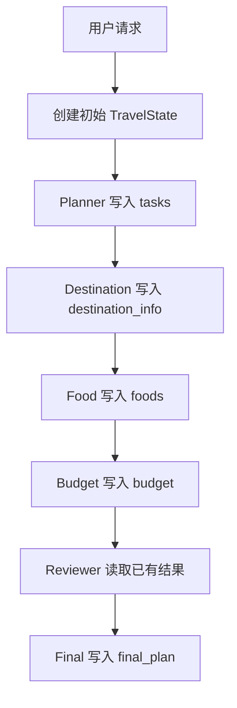
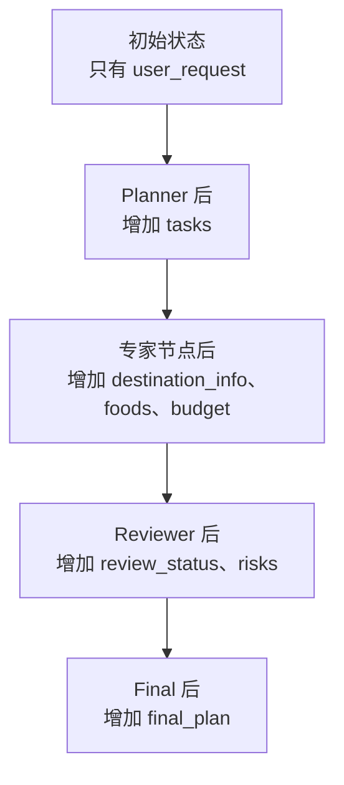

## Agent 分开以后，数据放在哪里

把旅行规划拆成 Destination、Food 和 Budget 等 Agent 后，新问题马上出现了：FoodAgent 怎样知道用户要去杭州？Reviewer 又去哪里读取前三个 Agent 的结果？

最直接的办法是让 Agent 互相调用：

```python
destination = destination_agent(request)
foods = food_agent(request, destination)
budget = budget_agent(request, destination, foods)
result = reviewer_agent(destination, foods, budget)
```

任务一多，函数参数会越来越长，执行顺序也被写死。任何 Agent 想增加一个结果，后面的调用都可能跟着修改。

LangGraph 采用另一种思路：准备一份共享状态，让节点读取它，再返回需要更新的字段。状态可以理解成旅行策划小组共用的一张工作单。



图中的箭头表示状态继续向后流动。每个节点看到的都是同一类 `TravelState`，但其中已经填写的栏目会越来越多。

## 先区分用户请求和工作流状态

Voyager-AI 用 `TravelRequest` 保存用户输入：

```python
class TravelRequest(BaseModel):
    destination: str
    days: int
    people: int
    budget: Decimal
    interests: list[str]
    pace: str
```

Pydantic 的 `BaseModel` 会在程序入口检查字段类型和范围。这里的数据回答“用户想去哪里、有什么要求”。

工作流内部使用 `TravelState`：

```python
class TravelState(TypedDict):
    user_request: TravelRequest
    tasks: list[str]
    destination_info: list[DestinationEntry]
    foods: list[FoodEntry]
    budget: BudgetPlan | None
    risks: list[str]
    review_status: str
    revision_count: int
    final_plan: str
```

`TypedDict` 仍然是普通字典，只是提前声明了允许出现的字段和类型。编辑器与类型检查器因此能发现 `destination_info` 拼错之类的问题。

两者的区别是：`TravelRequest` 在一次任务中基本不变；`TravelState` 会随着节点执行逐渐被填满。

## 状态是怎样变化的

工作流开始时，状态大致是：

```python
{
    "user_request": request,
    "tasks": [],
    "destination_info": [],
    "foods": [],
    "budget": None,
    "risks": [],
    "review_status": "pending",
    "revision_count": 0,
    "final_plan": "",
}
```

Planner 不需要复制完整字典，只返回：

```python
{"tasks": ["destination", "food", "budget", "review", "final"]}
```

FoodAgent 也只返回：

```python
{"foods": [{"name": "杭州本地风味", "category": "local"}]}
```

LangGraph 会把这些局部更新合并回状态。Agent 不需要知道其他节点的函数地址，也不需要主动把结果传给下一个 Agent。



## 为什么统一创建初始状态

项目使用 `create_initial_state(request)` 创建工作单，而不是在每个入口手写空字典。这样可以保证所有字段都有初始值，也避免不同请求共享同一份列表。

如果把空列表放在一个全局默认对象里，第一次任务向 `foods` 添加数据后，第二次任务可能读到同一份内容。测试会创建两份初始状态，修改其中一份，再确认另一份没有变化。

## 状态不是越大越好

共享状态虽然方便，也很容易变成什么都往里塞的“公共垃圾桶”。Voyager-AI 没有把模型客户端、API Key、数据库 Session 或 HTTP Request 放进 `TravelState`。

状态只保存工作流真正需要流转的业务数据。模型连接属于依赖，workflow id 属于运行上下文，数据库连接属于后端基础设施。把它们分开后，状态才能安全序列化、测试和持久化。

## 总结

Agent 之间不一定要直接互相调用。让它们围绕一份结构明确的状态工作，可以减少参数传递，也能让节点只关心自己读写的字段。

`TravelRequest` 保存不会随流程改变的用户要求，`TravelState` 记录逐步产生的旅行数据，LangGraph 负责把节点返回的局部结果合并进去。共享状态真正解决的，是多个 Agent 怎样在不过度耦合的情况下共同完成一件事。
