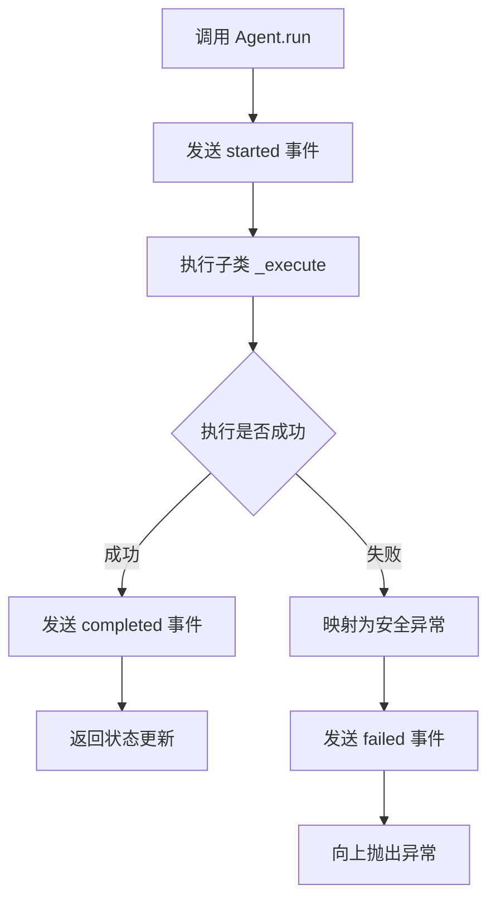
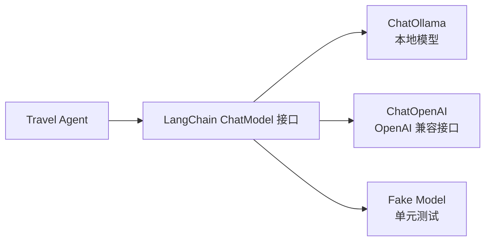

## Agent 并不是一种特殊语法

在代码里，Agent 可以从一个普通类开始：读取状态，执行任务，返回更新。

```python
class FoodAgent:
    def run(self, state: TravelState) -> dict[str, object]:
        destination = state["user_request"].destination
        return {
            "foods": [{"name": f"{destination}本地风味"}]
        }
```

随着角色增加，每个 Agent 都需要记录开始和结束、计算耗时、处理异常。如果把这些逻辑复制六遍，很快会出现不同版本。



这张图就是 `BaseAgent.run` 的固定骨架。Destination、Food、Budget 等子类只替换中间的 `_execute`，前后的生命周期处理保持一致。

## BaseAgent 负责共同生命周期

Voyager-AI 把公共流程放进 `BaseAgent.run`：

```python
def run(self, state, context):
    self.event_sink.emit(
        AgentEvent.started(context.workflow_id, self.name)
    )
    started_at = perf_counter()

    try:
        update = self._execute(state)
    except Exception as error:
        mapped = map_agent_exception(error)
        self.event_sink.emit(AgentEvent.failed(...))
        raise mapped from error

    self.event_sink.emit(AgentEvent.completed(...))
    return update
```

子类只实现 `_execute`。这是一种模板方法：父类固定执行骨架，子类填入角色自己的工作。

`event_sink` 可以理解成事件接收器。内存测试可以把事件放进列表，后端则可以把它们写入数据库。Agent 不需要知道事件最终存在哪里。

## 为什么先保留确定性执行

DestinationAgent 在没有模型时使用固定规则：

```python
def _execute(self, state):
    if self.model is not None:
        result = self._invoke_model(state, DestinationEntry)
        return {"destination_info": [result.model_dump()]}

    request = state["user_request"]
    return {
        "destination_info": [{
            "name": request["destination"],
            "description": "围绕兴趣安排的旅行",
            "best_time": "按当季天气灵活安排",
        }]
    }
```

确定性模式不联网，相同输入得到相同结果。它适合验证工作流顺序和数据结构。模型模式则适合生成更丰富的内容。

这里没有在模型失败时偷偷退回固定结果。否则线上模型已经出错，接口却返回一份看似成功的默认计划，问题会被隐藏。

## LangChain 统一不同模型

项目可以创建 `ChatOllama` 或 `ChatOpenAI`。两者底层服务不同，但都符合 LangChain 的聊天模型接口。Agent 因此只依赖“能够进行结构化调用的模型”，不依赖某个厂商 SDK。

这种做法叫依赖倒置：上层业务依赖稳定接口，具体模型实现可以替换。



```python
class StructuredChatModel(Protocol):
    def with_structured_output(self, schema): ...
```

`Protocol` 是 Python 的结构化接口。一个对象只要提供所需方法，就可以被 Agent 使用。

## AgentContext 为什么不放进状态

`AgentContext` 保存 workflow id，用于关联一次运行产生的事件。它不是旅行计划本身，所以不会写入 `TravelState`。

调用 `run(state, context)` 时，state 回答“正在规划什么”，context 回答“这是哪一次执行”。分开以后，旅行状态不会混入日志标识和运行配置。

## 总结

Voyager-AI 的 Agent 本质上仍然是普通 Python 对象。`BaseAgent` 统一生命周期，子类负责具体任务，LangChain 提供可替换的模型接口，Context 携带一次运行的附加信息。

把这些职责分开后，Agent 才能单独测试：既可以测试不联网的确定性结果，也可以用假模型验证结构化调用，还可以检查成功和失败事件是否正确产生。
