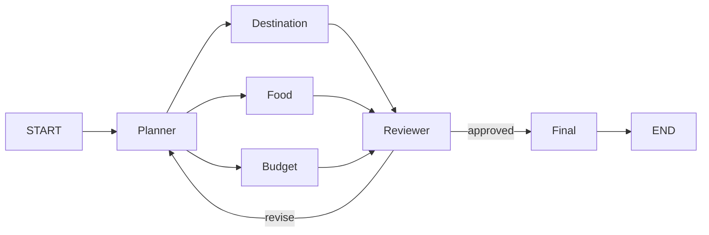

## 普通函数调用已经能工作

六个 Agent 完全可以手动串起来：

```python
state.update(planner.run(state))
state.update(destination.run(state))
state.update(food.run(state))
state.update(budget.run(state))
state.update(reviewer.run(state))
state.update(final.run(state))
```

对于永远不变的直线流程，这种写法很清楚。旅行规划却不完全是一条直线：三个专家可以分别工作，Reviewer 还可能要求返工。继续用 `if`、循环和函数调用堆下去，流程规则会散落在业务代码里。

LangGraph 用“图”把执行关系单独表达出来。



这张图比一串函数调用多表达了两件事：Planner 后出现了三条分支；Reviewer 也不一定继续向前，它可能回到 Planner。

## 节点和边是什么

图由节点（Node）和边（Edge）组成。

节点是一个处理步骤。在 Voyager-AI 中，Planner、Food、Budget 都是节点。节点接收 `TravelState`，返回局部更新。

边表示节点之间的执行关系。`planner -> food` 的意思是 Planner 完成后，Food 节点可以开始。

```python
builder = StateGraph(TravelState, context_schema=AgentContext)

builder.add_node("planner", planner_node)
builder.add_node("destination", destination_node)
builder.add_node("food", food_node)
builder.add_node("budget", budget_node)
builder.add_node("reviewer", reviewer_node)
builder.add_node("final", final_node)
```

`StateGraph(TravelState)` 表示所有节点围绕同一种状态工作。`context_schema` 则描述 workflow id 等不会写入业务状态的运行信息。

## START 和 END 不是 Agent

LangGraph 使用 `START` 和 `END` 标记入口与出口：

```python
builder.add_edge(START, "planner")
builder.add_edge("final", END)
```

它们不执行旅行任务，只告诉图从哪里开始、什么情况下算结束。缺少 END 的循环图可能一直运行，因此出口也是流程设计的一部分。

## Agent 怎样变成节点

LangGraph 节点通常是可调用对象。项目用 `_agent_node` 把 Agent 包装成符合节点签名的函数：

```python
def _agent_node(agent):
    def run(state: TravelState, runtime: Runtime[AgentContext]):
        context = runtime.context
        return AgentNode(agent, context)(state)

    return run
```

LangGraph 提供 state 和 runtime，包装函数取出 Context，再调用 Agent。这样 Agent 本身不需要导入 LangGraph，也能在图外单独测试。

## 编译以后怎样运行

节点和边添加完成后，调用 `builder.compile()` 得到可执行图。LangGraph 的可执行对象属于 Runnable，也就是具有统一调用方式的组件。

```python
graph = build_workflow()
result = graph.invoke(create_initial_state(request))
```

`invoke` 是同步执行；`ainvoke` 是异步执行；`stream` 和 `astream` 则可以逐步取得运行结果。项目用 `_TravelWorkflow` 包装编译图，同时保留这些调用方式。

## 图带来的价值不是画图好看

图把流程控制从 Agent 内部拿了出来。FoodAgent 不负责决定下一个节点，Reviewer 也不直接调用 Planner。角色逻辑改变时看 Agent，执行关系改变时看 workflow。

测试还可以读取编译图，检查 START 是否连接 Planner、Final 是否连接 END，而不必只靠一次完整运行猜测路径是否正确。

## 总结

普通函数调用适合简单直线流程。出现分支、汇合、返工和流式执行后，把执行关系表示成图会更容易理解和测试。

LangGraph 的基本思想并不神秘：节点负责处理数据，边负责安排顺序，StateGraph 负责让状态在节点之间流动。Voyager-AI 使用它，不是为了让 Agent 自动变聪明，而是为了把越来越复杂的流程规则放到一个看得见的位置。
