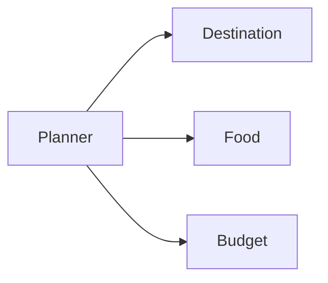
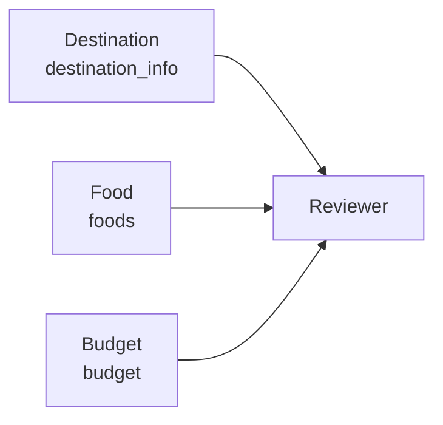

## 顺序执行并不总是必要

Destination、Food 和 Budget 都读取同一份用户请求。预算计算不需要等待餐饮建议，FoodAgent 也不依赖 DestinationAgent 的介绍。如果仍然一个接一个运行，只会增加总等待时间。

普通 Python 可以用并发任务处理，但还要自己收集结果、处理异常并合并字典。LangGraph 允许直接用多条边表示这种关系。

## 从一个节点分出三条边

```python
builder.add_edge("planner", "destination")
builder.add_edge("planner", "food")
builder.add_edge("planner", "budget")
```

这种“从一个节点分到多个节点”的结构常被称为 fan-out，也就是扇出。



Planner 完成后，三个节点都具备运行条件。它们读取 Planner 更新后的状态，各自返回不同字段。

这里说“可以并行”，重点是节点没有数据依赖。实际运行是否占用多个线程或进程，还取决于节点是同步还是异步、模型客户端如何实现。图描述的是依赖关系，不是对底层并发方式的承诺。

## 三份结果怎样汇合

Reviewer 必须等目的地、餐饮和预算都完成。LangGraph 用列表形式声明汇合边：

```python
builder.add_edge(
    ["destination", "food", "budget"],
    "reviewer",
)
```



这不是“任何一个完成就进入 Reviewer”，而是一个 barrier（屏障）：三条分支都到达后，Reviewer 才能继续。

## 并行写状态为什么没有互相覆盖

三个 Agent 返回不同字段：

```python
# DestinationAgent
{"destination_info": [...]}

# FoodAgent
{"foods": [...]}

# BudgetAgent
{"budget": {...}}
```

因此合并没有冲突。如果两个并行节点都写 `foods`，就必须明确使用哪个结果，或者为该字段配置 reducer（归并规则）。Reducer 可以理解成“多个更新同时到来时，应该怎样组合”。

Voyager-AI 当前不需要复杂 reducer，因为并行节点有各自的写入范围。这也是拆 Agent 时明确输出边界的重要性。

## 测试怎样证明汇合有效

工作流测试会替换节点，记录实际调用情况。Reviewer 运行时检查三份专家结果是否都已经出现在状态中，而不是只看最终计划有没有生成。

图结构测试还会读取编译图，确认 Planner 有三条出边，并且三个专家共同连接 Reviewer。这样修改某条边时，流程契约会立即失败。

## 总结

多个 Agent 能不能同时工作，不取决于角色名称，而取决于数据依赖。只读取共同输入、写入不同字段的任务，适合从同一节点分支；需要完整结果的审核步骤，则应该放在汇合点之后。

LangGraph 的分支和汇合把这种依赖直接画进工作流。它减少的不只是运行时间，也避免把并发控制、结果收集和下一步调用散落在各个 Agent 中。
