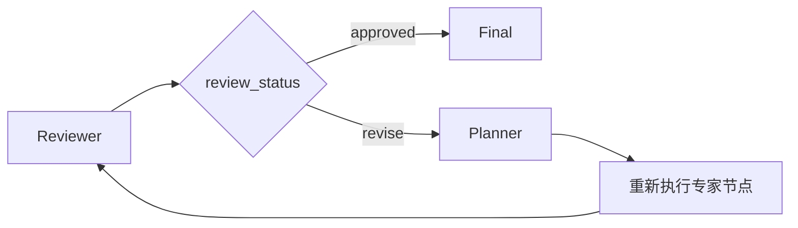

## 工作流不一定永远向前

三个专家完成后，Reviewer 会检查目的地、餐饮和预算是否齐全。通过就进入 Final；缺少内容则需要返工。

普通边只能表达固定的下一步。LangGraph 的条件边（conditional edge）会根据当前状态选择路线。



## 路由函数只负责做选择

```python
def route_after_review(
    state: Mapping[str, object],
) -> Literal["planner", "final"]:
    if state["review_status"] == "revise":
        return "planner"
    return "final"
```

`Literal` 表示返回值只能是两个指定字符串。路由函数不修改状态，也不直接调用节点，它只回答“下一站叫什么”。

随后把返回值映射到真实节点：

```python
builder.add_conditional_edges(
    "reviewer",
    route_after_review,
    {
        "planner": "planner",
        "final": "final",
    },
)
```

把判断写成独立函数后，可以直接构造两份状态测试它，不必每次运行整张图。

## Reviewer 怎样给出决定

确定性 Reviewer 会检查三个必需字段：

```python
required = ("destination_info", "foods", "budget")
risks = [key for key in required if not state[key]]

if not risks:
    return {"review_status": "approved", "risks": []}
```

发现缺失项时返回 `revise`，同时增加 `revision_count`。使用模型时，Reviewer 会把状态交给 `ReviewResult` Schema，模型仍然只能在规定的状态和问题列表中返回结果。

## 循环必须有停止条件

只要图里有一条回到前面节点的边，就可能无限执行。模型如果持续返回 `revise`，任务会不断消耗时间和 Token。

Voyager-AI 把修订次数限制为一次：

```python
if result.status == "revise" and state["revision_count"] < 1:
    return {
        "review_status": "revise",
        "revision_count": state["revision_count"] + 1,
        "risks": result.issues,
    }

return {
    "review_status": "approved",
    "risks": result.issues,
}
```

这个策略并不完美。第二次仍有问题时，它会保留 risks 并结束流程，而不是保证方案已经没有问题。它解决的是工程上的“流程必须终止”，不是内容质量上的“计划一定正确”。

真实产品还可以选择失败、转人工审核或只重跑缺失节点。关键是必须明确达到上限后怎么办。

## 总结

条件边让工作流根据状态选择下一步，循环让 Agent 有机会修正结果，计数器则保证返工不会无限持续。

Reviewer 的价值不只是再调用一次模型，而是把“什么情况下继续、什么情况下返工”变成程序能够测试的规则。对于任何带自我修正的 Agent 系统，停止条件和返工条件同样重要。
