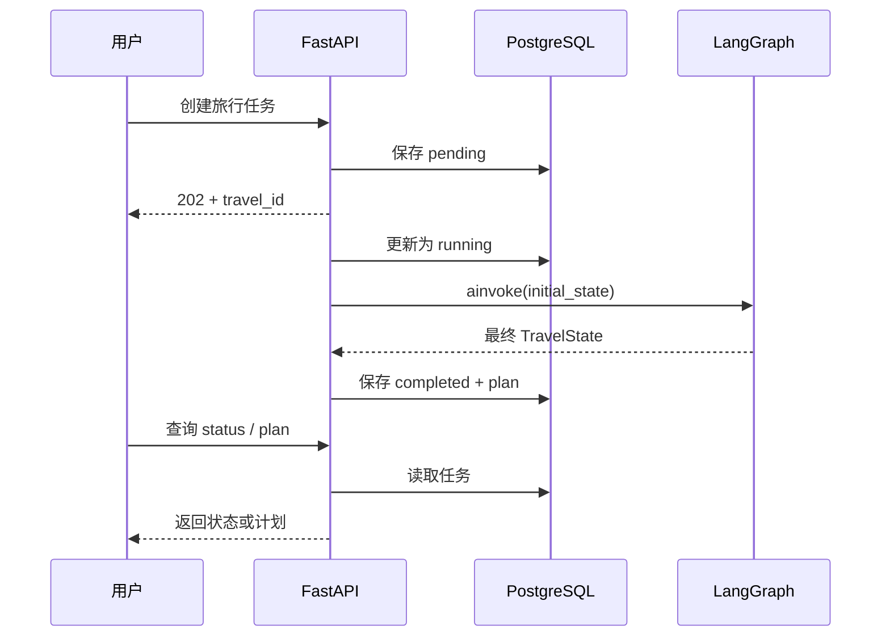
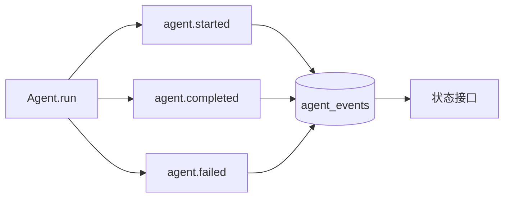

## graph.invoke 只是最小起点

本地脚本可以直接执行：

```python
result = graph.invoke(initial_state)
```

真实应用还要面对耗时、并发、失败和查询。一次六节点模型工作流可能运行几分钟，HTTP 请求不能一直让用户看着空白页面。

Voyager-AI 把一次执行包装成旅行任务：先返回 id，后台运行图，用户随后查询状态和结果。



## Runnable 提供统一执行方式

LangGraph 编译结果遵循 LangChain Runnable 接口。常见方法有：

- `invoke`：同步执行并等待最终结果；
- `ainvoke`：异步执行；
- `stream`：同步逐步返回结果；
- `astream`：异步流式返回。

项目用 `_TravelWorkflow` 包装编译图，在每次调用时补充 `AgentContext`，同时把 config 和其他参数继续传给底层 Runnable。包装层没有把 LangGraph 重新实现一遍。

## 事件让黑盒过程可观察

每个 Agent 会发出 started、completed 或 failed 事件。事件只保存角色、时间、耗时和安全错误码，不保存 Prompt、模型原文或 API Key。



workflow id 用来关联一次图运行，travel id 用来关联一项持久化任务。它们属于运行上下文和后端记录，不应该混进模型看到的旅行状态。

## API 为什么先返回 202

创建接口返回 `202 Accepted` 和 `travel_id`。202 表示服务器接收了任务，但尚未完成。

```text
POST /api/travel/create
GET  /api/travel/{travel_id}/status
GET  /api/travel/{travel_id}/plan
```

任务不存在返回 404；任务存在但计划未完成时返回 409；只有 completed 才返回计划。明确状态比返回空 JSON 更容易让前端处理。

## PostgreSQL 保存什么

数据库保存用户请求、pending/running/completed/failed 状态、时间戳、安全事件和最终计划。Repository 在状态迁移前检查旧状态，避免 completed 任务再次运行。

但持久化结果不等于持久化执行。当前后台工作仍使用 FastAPI `BackgroundTasks`，API 进程重启可能中断运行中的图。Redis 已在基础设施中，但真正可恢复的 Worker 还没有实现。

## 总结

把 LangGraph 接入应用，不只是把 `graph.invoke` 放进路由。耗时工作需要任务 id，执行过程需要安全事件，结果需要状态校验与持久化，HTTP 接口也要表达“已接收”和“已完成”的区别。

LangChain 与 LangGraph 负责模型和工作流，FastAPI 与 PostgreSQL 负责把它们变成用户可以提交、等待和查询的服务。边界分清后，每一层才能独立测试，也不会把模型调用、数据库事务和 HTTP 响应揉在一个函数里。
