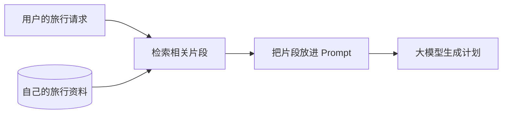
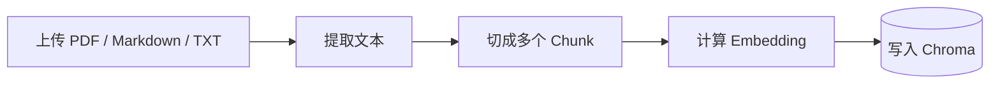
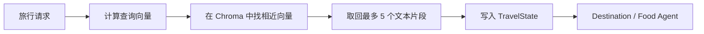

## 模型不知道我刚上传的攻略

前面的旅行规划已经能调用大模型了，但有个问题一直绕不过去：模型只知道训练时学到的内容，不知道我手里的私人资料。

比如我上传了一份自己整理的西安旅行笔记，里面写着：

```text
西安城墙永宁门早上游客相对少。
骑行一圈通常需要两到三个小时。
如果只走永宁门附近的城墙，可以预留一小时左右。
```

用户随后问“西安三日游怎么安排”，模型不会自动读取这份文件。把整份文件直接塞进 Prompt 也不太合适：文件可能很长，输入 Token 有上限，而且大部分内容和这次问题无关。

Voyager-AI 在这里加入了 RAG。

RAG 是 Retrieval-Augmented Generation 的缩写，中文一般叫“检索增强生成”。这个名字有点长，实际做的事情很直白：先从自己的资料中找出与问题有关的几段文字，再把这些文字交给模型生成答案。



重点在“先找再问”。RAG 没有重新训练模型，也没有把文件永久写进模型里。

## 一套 RAG 实际上有两条流程

刚接触 RAG 时，我把“上传文件”和“查询资料”混在一起理解，越看越乱。拆开后就清楚了。

第一条是索引流程，只在上传或更新文档时执行：



第二条是检索流程，每次规划旅行时执行：



索引是提前整理资料，检索是运行时查资料。两者用的是同一种 Embedding 模型，否则向量不在同一个坐标空间里，距离就没有比较意义。

## 为什么要把文档切成小块

Chunk 就是文档切出来的一个文本片段。项目默认每块 800 个字符，相邻两块重叠 120 个字符：

```python
def split_text(
    text: str,
    chunk_size: int = 800,
    overlap: int = 120,
) -> list[str]:
    if chunk_size <= 0 or overlap < 0 or overlap >= chunk_size:
        raise ValueError(
            "overlap must be non-negative and smaller than chunk_size"
        )

    normalized = _normalize_whitespace(text)
    if not normalized:
        return []

    step = chunk_size - overlap
    chunks = []
    start = 0

    while start < len(normalized):
        chunks.append(normalized[start : start + chunk_size])
        if start + chunk_size >= len(normalized):
            break
        start += step

    return chunks
```

假设第一块是字符 `0～799`，下一块不会从 800 开始，而是从 680 开始。中间重复的 120 个字符用来保护上下文。

如果一句话刚好横跨切分位置，没有重叠时，两块文本都可能只剩半句话。适量重叠能缓解这个问题。当然，重叠越多，存储和计算也越多，并不是越大越好。

项目先把多余空白合并，再进行固定长度切分。这不是最聪明的切分算法，但很好理解，也容易验证。以后如果文档结构更复杂，可以再按 Markdown 标题、自然段或句子切分。

## Embedding 不是摘要

Embedding 常译为“嵌入向量”。它会把一段文字转换成一组数字，例如：

```text
"西安早上适合去哪里" -> [0.018, -0.241, 0.763, ...]
```

这组数字不是给人读的，也不是文章摘要。它表示文本在语义空间中的位置。含义相近的文本，向量距离通常更近。

于是“西安早上适合去哪里”和“西安城墙永宁门早上游客相对少”即使没有完全相同的关键词，也有机会被匹配到。

项目通过一个很小的协议隔离具体供应商：

```python
class EmbeddingProvider(Protocol):
    async def embed_documents(
        self, texts: list[str]
    ) -> list[list[float]]:
        ...

    async def embed_query(self, text: str) -> list[float]:
        ...
```

`embed_documents` 用于索引文档，`embed_query` 用于处理用户问题。目前可以接 Ollama 或智谱 Embedding，后面的索引和检索代码不需要知道具体调用的是谁。

这里还有一个容易忽略的检查：返回的向量数量、维度和每个数字都必须有效。模型服务返回 HTTP 200，不代表响应一定能用。少一个向量、混入字符串或出现 `NaN`，都应该在写入向量库前被拒绝。

## 文档是怎样进入向量库的

Voyager-AI 的索引服务把解析、切分、向量化和写入串在一起：

```python
async def index(self, document_id: UUID) -> None:
    document = await self._repository.get(document_id)
    document = await self._repository.transition(
        document_id, "processing"
    )

    text = parse_document(
        self._storage.path(document.storage_name),
        document.content_type,
    )
    texts = split_text(text, chunk_size=800, overlap=120)

    for start in range(0, len(texts), 32):
        batch_texts = texts[start : start + 32]
        embeddings = await self._embeddings.embed_documents(batch_texts)
        chunks = [
            KnowledgeChunk(
                document_id=document.id,
                filename=document.display_filename,
                chunk_index=index,
                text=chunk_text,
                score=0.0,
            )
            for index, chunk_text in enumerate(batch_texts, start=start)
        ]
        await self._vector_store.add_chunks(chunks, embeddings)

    await self._repository.transition(
        document_id, "ready", chunk_count=len(texts)
    )
```

Repository 可以先理解成“负责读写数据库的对象”。数据库保存文档的文件名、处理状态和分块数量；原文件放在文件存储中；文本块及其向量放在 Chroma。

为什么要有 `processing`、`ready`、`failed` 这些状态？因为索引不是一次普通的数据库插入。解析 PDF、请求 Embedding 服务、写入 Chroma，任何一步都可能失败。只有 `ready` 的文档才能参与检索，半成品不能混进去。

## 检索时到底拿什么去搜索

旅行请求不是一句随意聊天，项目已经有结构化字段，所以查询文本直接由这些字段组成：

```python
query_text = (
    f"Destination: {query.destination}\n"
    f"Interests: {', '.join(query.interests)}\n"
    f"Pace: {query.pace}"
)

embedding = await self._embeddings.embed_query(query_text)
matches = await self._vector_store.search(embedding, limit=5)
```

例如：

```text
Destination: 西安
Interests: 历史建筑, 摄影
Pace: relaxed
```

向量库返回距离最近的文本块。检索服务还会做两层限制：最多取 5 块，总字符数最多 6000。这个限制很重要。RAG 找到的是“可能相关”的资料，不应该不加节制地占满模型上下文。

```python
context = []
used_chars = 0

for chunk in matches:
    if chunk.document_id not in ready_ids:
        continue
    if used_chars + len(chunk.text) > 6000:
        break

    context.append(chunk.text)
    used_chars += len(chunk.text)
```

## RAG 怎样接入 LangGraph

检索结果最后要交给 Agent。项目没有让 Agent 自己偷偷访问数据库，而是把 RAG 做成一个明确的 LangGraph 节点：

```python
builder.add_node("knowledge_retriever", knowledge_node)

builder.add_edge(START, "planner")
builder.add_edge("planner", "knowledge_retriever")
builder.add_edge("knowledge_retriever", "context_tools")
```

节点把结果写进共享状态：

```python
return {
    "knowledge_context": list(result.context),
    "knowledge_sources": [
        source.model_dump() for source in result.sources
    ],
    "risks": risks,
}
```

`knowledge_context` 是给模型看的文本，`knowledge_sources` 是给应用展示的来源。两者用途不同，不能只留下拼接后的 Prompt，否则用户看不到建议来自哪份资料。

Destination Agent 和 Food Agent 在调用模型前，只挑选自己需要的状态：

```python
def destination_grounded_state(state: TravelState) -> dict[str, object]:
    return {
        "user_request": state["user_request"],
        "knowledge_context": state.get("knowledge_context", []),
        "weather_forecast": state.get("weather_forecast", []),
        "search_results": state.get("search_results", []),
    }
```

这里的 grounded 可以理解为“有依据的”。模型不再只凭自身记忆回答，而是能参考检索到的资料和实时数据。

## 检索失败时要不要让整个规划失败

Voyager-AI 选择继续运行，但在状态中记录安全错误码：

```python
try:
    embedding = await self._embeddings.embed_query(query_text)
except EmbeddingProviderError:
    return RetrievalResult((), (), "embedding_unavailable")
```

如果知识库临时不可用，旅行规划仍可依靠模型和其他工具完成，只是少了私人资料。前端可以显示“知识库暂不可用”，而不是把供应商异常和内部地址直接暴露给用户。

这是一种降级策略。它适合 RAG 只是增强能力的场景。如果你的业务要求回答必须以公司制度或法律文档为准，那就不能悄悄降级，应该直接停止生成。

## 总结

接入向量数据库只是其中一步。上传时需要解析、切分并建立索引；运行时还要把问题向量化，检索少量相关片段，再交给 Agent。

在 Voyager-AI 中，RAG 还是 LangGraph 的一个普通节点。它读取 `TravelRequest`，把资料写回 `TravelState`，下游 Agent 再决定怎样使用。数据从哪里来、什么时候进入流程、失败后怎么办，都能从图和状态中看出来。
