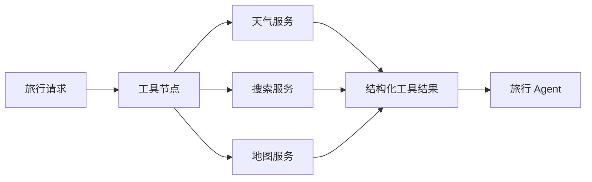
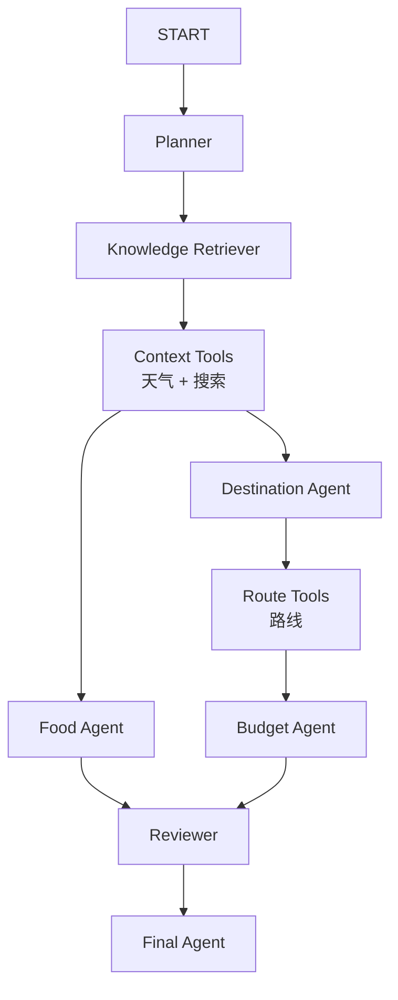

## 大模型会认真地说出过期信息

知识库解决了“模型不知道我的资料”，但旅行规划还有另一类信息：天气、搜索结果和路线时间。这些数据今天和明天可能就不一样，不能指望模型训练时已经记住。

如果问模型“下周成都是否下雨”，它也许会给出一段读起来很顺的回答。问题是，这段回答可能根本没有查天气。

这时需要 Tool，也就是 Agent 可以调用的外部工具。在 Voyager-AI 中，天气来自天气服务，地点信息来自搜索服务，路线由地图服务估算。模型负责理解和组织信息，工具负责提供可以查询的数据。



## Tool 不等于让模型随便请求网址

LangChain 里的 Tool 通常指一项具有明确名称、输入和输出的能力。模型可以选择调用它，也可以由程序在固定位置调用。

Voyager-AI 采用后者：工具节点由 LangGraph 调度，模型不能随意拼接 URL，也不能自己决定调用多少次。对旅行规划这种流程固定、外部接口需要控制成本的应用，这种方式更容易管理。

项目先定义工具结果的数据结构。例如一天的天气：

```python
class WeatherDay(BaseModel):
    date: date
    provider: Literal["open_meteo", "openweather"]
    weather_code: int = Field(ge=0, le=999)
    condition: str = Field(min_length=1, max_length=100)
    min_temperature_c: float
    max_temperature_c: float
    precipitation_probability: float = Field(ge=0, le=1)
```

`Literal` 表示只能取列出的值；`Field` 给字段加上范围。降水概率必须在 0 到 1 之间，供应商只能是已接入的两个名字。

外部接口返回的是不可信输入。哪怕服务商文档写得很清楚，也可能遇到字段缺失、类型改变、代理返回 HTML 或测试配置出错。先转换成自己的 Pydantic 模型，后面的 LangGraph 节点和 Agent 才不用到处判断脏数据。

## 为什么工具分成两组

当前工作流不是把三个工具一起执行。天气和搜索只依赖用户请求，可以在规划景点前运行；路线需要先知道 Destination Agent 选出了哪些地点。



这张图里的位置就是数据依赖关系：

- 天气和搜索只需要 `TravelRequest`，所以放在 Destination 和 Food 之前；
- 路线需要目的地列表，所以放在 Destination 之后；
- Budget 需要参考路线信息，所以放在 Route Tools 之后；
- Food 与路线预算没有直接依赖，仍可以走另一条分支。

设计 LangGraph 时，先问“这个节点需要哪些数据”，比先画一张看起来很复杂的图更有用。

## 用 Protocol 留出工具边界

AI Engine 不应该知道天气 API 的地址、密钥或 HTTP 响应格式。它只声明自己需要什么：

```python
class ContextToolEnricher(Protocol):
    def enrich(self, request: TravelRequest) -> ContextToolResult:
        ...


class RouteToolEnricher(Protocol):
    def enrich(
        self,
        request: TravelRequest,
        places: Sequence[str],
    ) -> RouteToolResult:
        ...
```

Protocol 可以理解为 Python 的“能力约定”。一个对象只要有相同的方法，就可以传给工作流，不要求继承某个基类。

`build_workflow` 通过参数接收实现：

```python
def build_workflow(
    *,
    context_enricher: ContextToolEnricher | None = None,
    route_enricher: RouteToolEnricher | None = None,
    ...
):
    builder.add_node(
        "context_tools",
        _context_tool_node(context_enricher, event_sink),
    )
    builder.add_node(
        "route_tools",
        _route_tool_node(route_enricher, event_sink),
    )
```

这样做的直接好处是，AI Engine 可以使用假工具做测试，FastAPI 后端再注入真实服务。换天气供应商时也不必修改 Agent。

## 工具节点怎样更新 TravelState

上下文工具节点先把 `TravelState` 中的用户请求验证为 `TravelRequest`，再调用 Enricher：

```python
request = TravelRequest.model_validate(state["user_request"])
result = enricher.enrich(request)

return {
    "weather_forecast": [
        item.model_dump(mode="json")
        for item in result.weather_forecast
    ],
    "search_results": [
        item.model_dump(mode="json")
        for item in result.search_results
    ],
    "tool_sources": [
        item.model_dump(mode="json")
        for item in result.tool_sources
    ],
    "tool_warnings": list(result.tool_warnings),
    "tool_context": result.tool_context,
}
```

这里同时保留了三种数据：

`weather_forecast` 和 `search_results` 是机器容易处理的结构化结果；`tool_sources` 用于向用户说明来源；`tool_context` 是整理后交给模型阅读的短文本。

只保存 `tool_context` 会丢掉字段结构，只保存原始 JSON 又会让 Prompt 变得又长又乱。两份表示各有用途。

## 路线节点为什么还要合并旧状态

路线工具运行时，天气和搜索已经写进状态。它不能用自己的结果把旧的来源和警告覆盖掉：

```python
sources = [
    *state["tool_sources"],
    *(item.model_dump(mode="json") for item in result.tool_sources),
]

warnings = list(
    dict.fromkeys(
        (*state["tool_warnings"], *result.tool_warnings)
    )
)

context = "\n".join(
    part
    for part in (state["tool_context"], result.tool_context)
    if part
)

return {
    "route_legs": [
        item.model_dump(mode="json")
        for item in result.route_legs
    ],
    "tool_sources": sources,
    "tool_warnings": warnings,
    "tool_context": context[:6000],
}
```

`dict.fromkeys(...)` 在这里用来按原顺序去重。`context[:6000]` 则给模型输入设置上限。工具越多，越要明确哪些字段追加、哪些覆盖、哪些需要截断。

## 同步 LangGraph 和异步 HTTP 怎么接

后端的天气、搜索和地图服务使用 `async def`，因为它们要等待网络。当前 LangGraph 工具节点是同步函数。直接在同步函数里写 `asyncio.run()` 看似省事，但 FastAPI 已经运行着事件循环，嵌套启动很容易报错。

事件循环可以先理解为“异步任务的调度器”。FastAPI 的网络请求和数据库操作都在它上面运行。

项目的适配器把协程提交回 FastAPI 所在的事件循环，再在图运行的工作线程中等待结果：

```python
future = asyncio.run_coroutine_threadsafe(
    self._service.enrich(request),
    self._owner_loop,
)

try:
    return future.result(timeout=30.0)
except FutureTimeoutError:
    future.cancel()
    return ContextToolResult(
        tool_warnings=("tool_timeout",)
    )
except Exception:
    return ContextToolResult(
        tool_warnings=("tool_data_invalid",)
    )
```

这层代码不是 LangGraph 的必需写法，而是当前同步图节点与异步后端之间的桥。以后如果整条执行链都改成异步工具节点，这个适配器也可以被删掉。

## 工具失败不应该伪装成“没有数据”

天气接口超时和“未来几天没有降雨”完全不是一回事。前者是失败，后者是有效结果。如果都返回空列表，下游无法区分。

项目给失败结果附上稳定错误码：

```python
ToolWarningCode = Literal[
    "weather_unavailable",
    "search_unavailable",
    "map_unavailable",
    "currency_unavailable",
    "tool_data_invalid",
    "tool_timeout",
]
```

错误码比原始异常更适合跨层传递。前端可以把 `weather_unavailable` 显示成中文提示，日志里仍然记录详细异常，但不会把 API Key、内部 URL 或供应商响应带进模型上下文。

每次工具调用还会发出 started、completed、failed 事件。于是用户能看到“正在查询天气”，开发时也能知道一次慢请求卡在哪个工具上。

## 最终输出前要清理临时上下文

`tool_context` 是给 Agent 生成计划时使用的中间材料。最终节点运行后，工作流会把它清空：

```python
def clearing_final_node(node):
    def run(state: TravelState) -> dict[str, object]:
        return {
            **node(state),
            "tool_context": "",
        }

    return run
```

结构化的天气、路线和来源仍然保留，临时拼接的 Prompt 文本不需要进入持久化结果。把“模型运行需要的数据”和“产品最后应该保存的数据”分开，状态才不会越积越大。

## 总结

给 Agent 接工具时，HTTP 请求只占很小一部分。调用时机、外部数据校验、状态合并、超时处理和来源记录都需要在代码中说清楚。

Voyager-AI 把工具放进 LangGraph 的固定节点中。天气和搜索在规划前执行，路线在目的地产生后执行。模型只能使用经过验证和裁剪的数据，工具失败则留下明确警告。这样得到的旅行计划可能少一项实时信息，但不会拿一段来路不明的数据继续编下去。
