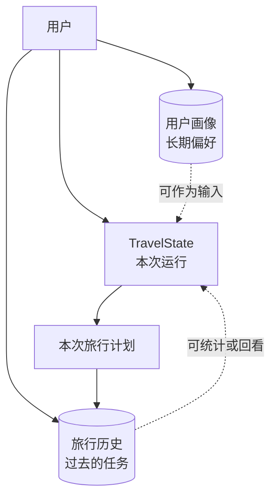
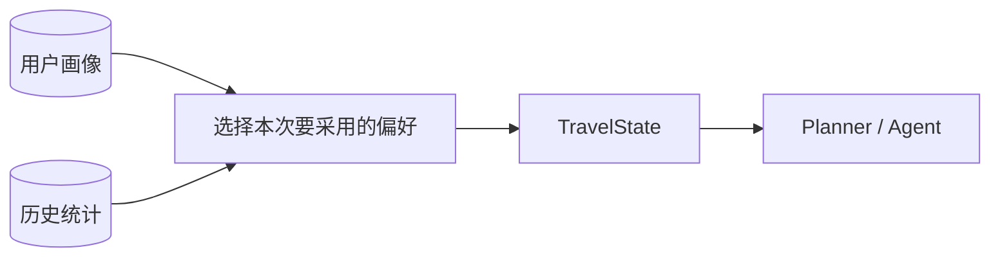

## TravelState 不是用户记忆

前面一直在使用 `TravelState`。Planner 写入任务，Destination Agent 写入景点，Reviewer 再读取这些结果。看起来 Agent 已经“记住”了很多信息。

但这份状态只属于当前一次旅行规划。图执行结束后，再创建一个新任务，会得到一份新的 `TravelState`。它不知道用户上次去了哪里，也不知道用户长期不吃辣。

Agent 项目里有三个经常被混用的概念：

- 状态：一次工作流运行期间共享的数据；
- 画像：用户明确保存、以后还想继续使用的偏好；
- 历史：过去实际创建过的任务和结果。

它们都和“记住”有关，生命周期却不同。



## 先看一次运行里的状态

创建工作流时，项目会生成初始状态：

```python
def create_initial_state(request: TravelRequest) -> TravelState:
    return {
        "user_request": request.model_dump(),
        "tasks": [],
        "destination_info": [],
        "foods": [],
        "budget": {},
        "review_status": "pending",
        "revision_count": 0,
        "risks": [],
        "knowledge_context": [],
        "knowledge_sources": [],
        "weather_forecast": [],
        "search_results": [],
        "route_legs": [],
        "tool_sources": [],
        "tool_warnings": [],
        "tool_context": "",
        "final_plan": "",
    }
```

LangGraph 的节点围绕这份状态协作。它的目标是让本次执行可以继续向前，而不是保存用户一辈子的偏好。

如果把用户画像也直接塞进每次运行状态，并指望 LangGraph 自动永久保存，就混淆了两件事：图负责怎样执行，数据库负责数据活多久。

## 用户画像保存明确偏好

Voyager-AI 的画像保存用户主动填写的信息，例如昵称、旅行节奏、预算偏好、兴趣、饮食偏好和备注。

领域对象可以简化成：

```python
class ProfileValues(BaseModel):
    display_name: str | None = None
    travel_pace: Literal["slow", "balanced", "fast"] | None = None
    budget_preference: Literal[
        "economy", "balanced", "comfort"
    ] | None = None
    interests: list[str] = Field(default_factory=list)
    dietary_preferences: list[str] = Field(default_factory=list)
    notes: str | None = None
```

用户画像适合存“我希望系统以后还记得”的内容，不应该靠模型从一句随口聊天里自行猜测。

例如用户这次写了“不想吃辣”，可能是当天胃不舒服，也可能是长期偏好。项目让用户在画像页面主动维护，含义更明确，也方便修改和删除。

保存画像时，Service 不直接写 SQL，而是调用 Repository：

```python
class MemoryService:
    def __init__(self, profiles, jobs) -> None:
        self._profiles = profiles
        self._jobs = jobs

    async def get_profile(self) -> UserProfile:
        profile = await self._profiles.get_profile()
        return UserProfile() if profile is None else profile

    async def replace_profile(
        self,
        values: ProfileValues,
    ) -> UserProfile:
        return await self._profiles.upsert_profile(values)
```

Service 放业务规则，Repository 处理数据库读写。这里使用 `upsert`，表示记录不存在就新增，已经存在就更新。

## 历史记录保存发生过什么

历史不是另一份画像。它来自已经创建的旅行任务，包括请求、状态、计划和完成时间。

```text
GET    /api/memory/history
GET    /api/memory/history/{travel_id}
DELETE /api/memory/history/{travel_id}
```

列表接口支持分页，不会一次把所有计划都返回；详情接口读取某一次旅行；删除接口只允许删除已经结束的任务。

```python
async def delete_history(self, travel_id: UUID) -> None:
    job = await self._jobs.get(travel_id)

    if job is None:
        raise MemoryNotFound

    if job.status in {"pending", "running"}:
        raise TravelJobActive

    deleted = await self._jobs.delete_terminal(travel_id)
    if not deleted:
        raise MemoryNotFound
```

terminal 在这里不是命令行，而是“终态”。`completed` 和 `failed` 都已经结束；`pending` 和 `running` 还可能被后台任务更新。

运行中的任务不能随便删除，否则后台完成后可能继续更新一条已经不存在的记录，或者留下无法对应的 Agent 事件。

## 从历史推导偏好，而不是让模型猜

有了历史数据，可以计算一些简单统计：完成过多少次规划、最常去哪里、典型预算是多少、平均旅行天数是多少。

这些统计不需要大模型。Python 就能稳定完成，而且每次运行结果都一致。

### 典型预算为什么用中位数

假设用户四次旅行预算是：

```text
3000, 4500, 5000, 50000
```

最后一次可能是长途旅行。如果用平均数，结果会被 50000 明显拉高。项目使用中位数：

```python
budgets = sorted(trip.request.budget for trip in trips)
middle = len(budgets) // 2

typical_budget = (
    None
    if not budgets
    else budgets[middle]
    if len(budgets) % 2
    else (budgets[middle - 1] + budgets[middle]) // 2
)
```

四个值排序后，中间是 4500 和 5000，典型预算取两者平均，也就是 4750。这里用确定性算法比问模型“你觉得用户通常花多少钱”靠谱得多。

### 常见兴趣怎样处理并列

项目统计每个值出现的次数。如果次数相同，就把最近出现的排在前面：

```python
counts = Counter()
most_recent = {}

for trip in trips:
    for value in values_for(trip):
        counts[value] += 1
        most_recent[value] = max(
            most_recent.get(value, trip.completed_at),
            trip.completed_at,
        )

values = sorted(counts)
values.sort(key=lambda value: most_recent[value], reverse=True)
values.sort(key=counts.__getitem__, reverse=True)
```

Python 的排序是稳定的。最后一次按次数排序时，次数相同的项目会保留上一轮的最近时间顺序。

同一次请求里的重复兴趣还会先去重，避免用户误填两次“摄影”就被计算成两次偏好。

## 旧数据不能默认永远正确

项目继续开发后，`TravelRequest` 和最终计划的字段会变化。数据库里可能已经有旧版本记录，甚至有某次异常写入的残缺数据。

统计时如果直接访问：

```python
job.request["budget"]
```

遇到坏数据就可能让整个记忆页面报错。Voyager-AI 会逐条验证历史：

```python
def valid_completed_trip(job: object) -> CompletedTrip | None:
    try:
        if job.status != "completed":
            return None

        request = TravelRequest.model_validate(
            job.request,
            context=PERSISTED_TRAVEL_REQUEST_CONTEXT,
        )
        validate_completed_plan(job.plan)
    except (
        AttributeError,
        TypeError,
        ValueError,
        ValidationError,
        PlanValidationError,
    ):
        return None

    return CompletedTrip(request, job.completed_at)
```

一条损坏记录不会拖垮所有统计。详情接口则会明确返回持久化错误，提醒用户这条记录不可用。

“列表跳过坏项”和“详情报告坏项”并不矛盾。统计关注整体可用性，详情关注指定记录是否可信。

## 记忆什么时候进入 Agent

这是最容易过早实现的一步。项目已经提供画像、历史和统计接口，但不代表所有数据都应该自动塞进每次 Prompt。

如果以后要让画像参与规划，较清楚的做法是：在创建 `TravelRequest` 时让用户确认采用哪些默认值，或者增加一个独立的 memory 节点，把经过选择的少量偏好写入 `TravelState`。



不要把几十次历史计划全文交给模型。长期保存不等于每次都需要读取，读取了也不等于都应该进入 Prompt。

## 用户必须能查看和删除

只要系统声称有“记忆”，用户就应该能知道它记住了什么。Voyager-AI 提供画像编辑、历史查看和删除功能，没有把记忆藏在后台。

这也让调试简单很多。模型给出奇怪建议时，可以先确认本次请求、画像和历史统计分别是什么，而不是猜“模型可能记住了什么”。

## 总结

Agent 记忆不是一个字段，也不是把所有聊天记录丢给模型。一次 LangGraph 运行用 `TravelState` 协作，用户画像保存明确的长期偏好，旅行历史记录已经发生的任务。三者的生命周期和用途都不同。

Voyager-AI 先用 PostgreSQL 把画像与历史保存清楚，再用普通 Python 推导统计。至于哪些记忆应该进入下一次 Prompt，需要经过选择，而不是因为数据库里有，就全部交给模型。
