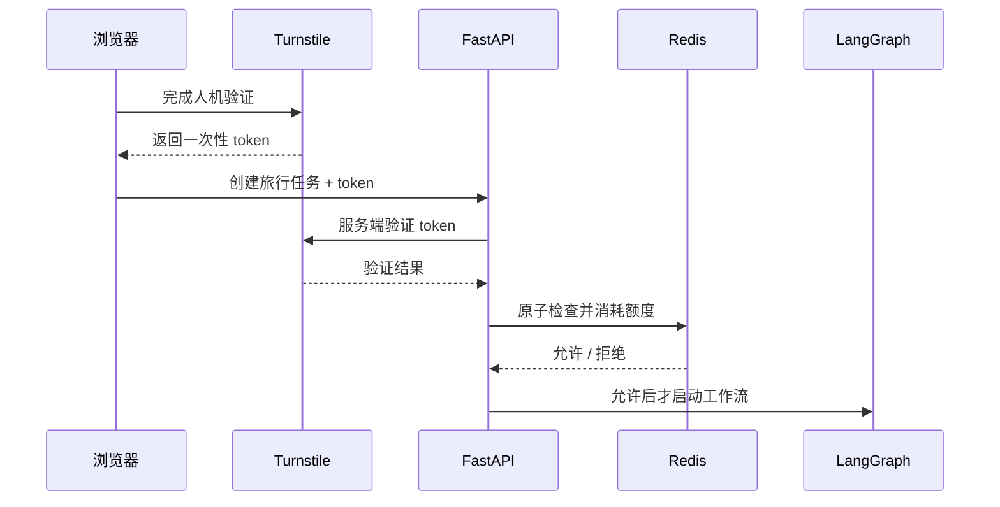
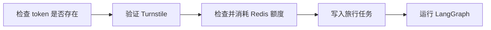
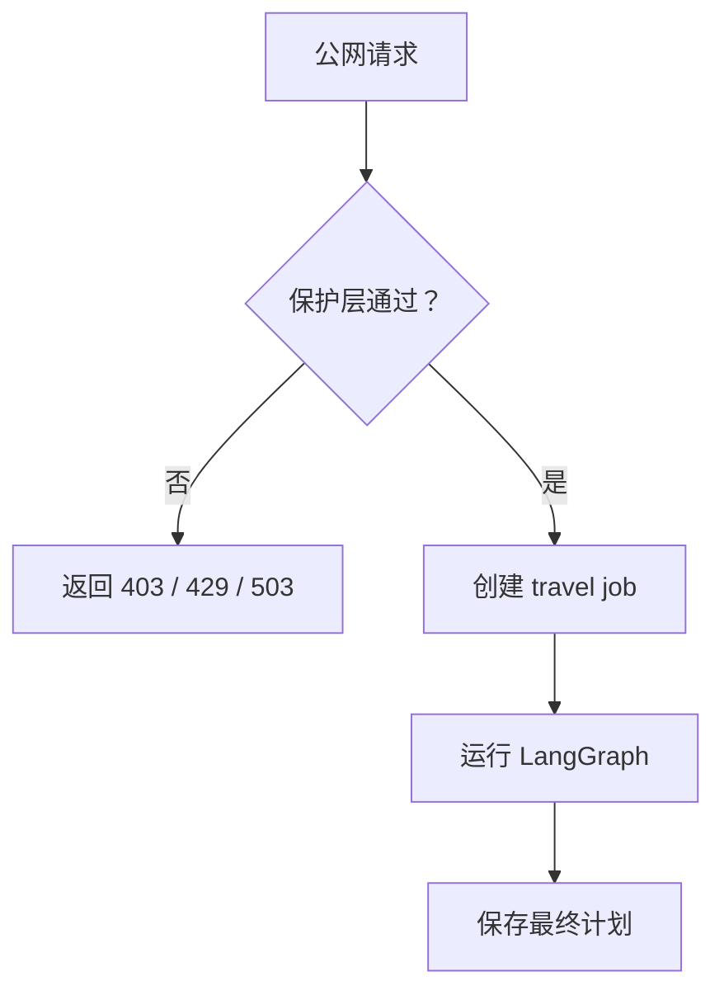

## 本地能跑，不代表适合直接公开

Voyager-AI 在本地运行时，调用模型、Embedding、天气和搜索服务的都是我自己。把它部署到公网后，情况变了：任何人都可以提交旅行任务，而每次任务都可能产生模型费用和外部 API 请求。

一个普通表单如果被脚本连续请求几千次，后端不会因为“这是学习项目”就自动停下来。最直接的结果是额度耗尽，严重一点还可能把数据库和第三方服务一起拖慢。

因此公开体验需要回答三个问题：

1. 这次请求像不像真人操作？
2. 这个来源今天用了多少次？
3. 整个站点今天还能创建多少任务？

Voyager-AI 使用 Cloudflare Turnstile 做人机验证，用 Redis 保存每日计数。验证或计数服务不可用时，创建接口拒绝请求，不会绕过保护继续调用模型。



## Turnstile 验证的是什么

Turnstile 是 Cloudflare 提供的人机验证服务。前端显示挑战组件，成功后拿到一个短期 token。这个 token 只能说明浏览器完成了一次挑战，后端仍然必须向 Cloudflare 验证。

如果只在前端判断“验证完成”，请求者可以绕过页面，直接调用 API。

后端验证代码的主要部分是：

```python
response = await http_client.post(
    "https://challenges.cloudflare.com/turnstile/v0/siteverify",
    data={
        "secret": settings.turnstile_secret_key.get_secret_value(),
        "response": token,
    },
)

payload = response.json() if response.is_success else None

if not isinstance(payload, dict):
    raise PublicDemoProtectionError(
        "demo_protection_unavailable"
    )

if (
    payload.get("success") is not True
    or payload.get("hostname") != settings.turnstile_hostname
):
    raise PublicDemoProtectionError("turnstile_failed")
```

除了 `success`，还要检查 `hostname`。否则为另一个网站签发的有效 token 也可能被拿来尝试调用当前接口。

Secret Key 只放在后端环境变量中。前端使用的是 Site Key，两者不能混用。

## 人机验证不能替代调用限额

真人也能连续点击，脚本也可能通过第三方服务拿到有效 token。Turnstile 提高了批量滥用的成本，但它不是计费系统。

项目又加了两层每日限额：

- 单个 IP 的每日上限，避免一个来源用光全部额度；
- 全站每日上限，保证模型费用有绝对封顶。

两个计数都放在 Redis 中。Redis 是内存数据存储，适合处理高频计数，也支持让键自动过期。

键中包含 UTC 日期：

```text
voyager:demo:ip:<ip_hash>:2026-08-31
voyager:demo:global:2026-08-31
```

项目不直接保存原始 IP，而是先计算 SHA-256：

```python
day = datetime.now(UTC).date().isoformat()
ip_hash = hashlib.sha256(client_ip.encode()).hexdigest()
```

哈希不是匿名化的万能方案，但至少避免把原始地址直接放进 Redis Key 和运维界面。

## 为什么检查和加一必须是一个操作

最容易写出的限额代码大概是这样：

```python
count = await redis.get(key)

if int(count or 0) >= limit:
    raise LimitReached()

await redis.incr(key)
```

单个请求时没有问题。两个请求同时到达时，它们可能都读到 `9`，都认为还没到上限 `10`，最后把计数加到 `11`。

这叫竞态条件：程序结果取决于多个操作碰巧以什么顺序执行。

Voyager-AI 使用一段 Redis Lua 脚本，把读取、判断、递增和设置过期时间放进同一次原子执行：

```lua
local ip_count = tonumber(redis.call('GET', KEYS[1]) or '0')
if ip_count >= tonumber(ARGV[1]) then return 0 end

local global_count = tonumber(redis.call('GET', KEYS[2]) or '0')
if global_count >= tonumber(ARGV[2]) then return -1 end

if redis.call('INCR', KEYS[1]) == 1 then
    redis.call('EXPIRE', KEYS[1], ARGV[3])
end

if redis.call('INCR', KEYS[2]) == 1 then
    redis.call('EXPIRE', KEYS[2], ARGV[3])
end

return 1
```

原子执行可以理解为：脚本运行期间，不会有另一个请求插进来改这两个计数。

返回值分别表示：

```text
 1  允许创建任务
 0  当前 IP 已到上限
-1  全站已到上限
```

过期时间设为 172800 秒，也就是两天。Key 中已经有日期，所以旧计数不会影响第二天；多保留一天只是给清理留出余量。

## 为什么先验证，再扣额度

执行顺序也会影响体验和成本：



无效 token 不应该消耗用户当天的旅行额度。反过来，只有额度已经成功扣除，后端才创建任务并启动 LangGraph，避免先产生模型调用再发现超限。

这里的“扣额度”并不保证模型一定成功。请求进入系统后，即使模型随后失败，这次额度也已经使用。否则攻击者可以专门制造失败请求来绕过计数。

## 失败关闭是什么意思

假设 Redis 暂时连不上。系统有两种选择：

```text
失败开放：限额检查失败，仍然允许调用模型
失败关闭：限额检查失败，拒绝创建任务
```

Voyager-AI 选择失败关闭，也叫 fail closed：

```python
try:
    result = await redis.eval(...)
except (OSError, RedisError):
    raise PublicDemoProtectionError(
        "demo_protection_unavailable"
    ) from None
```

公开演示的保护层一旦失效，系统无法知道调用量是否还在预算内。返回 503 比默默放行安全。

这不代表所有功能都必须失败关闭。上一篇里的天气工具只是增强信息，天气接口失败后仍可生成基础计划。这里保护的是费用和滥用边界，失效后继续运行的代价更高。

同一个项目里可以同时存在两种策略：

- RAG、天气、搜索失败：记录警告，降级完成旅行计划；
- 人机验证、限额计数失败：拒绝新的公开任务。

具体采用哪种策略，要看这个依赖守护的是什么。

## 错误码怎样交给前端

后端没有把所有失败都变成 500：

```python
class PublicDemoProtectionError(Exception):
    @property
    def status_code(self) -> int:
        if self.error_code in {
            "demo_ip_limit_reached",
            "demo_global_limit_reached",
        }:
            return 429

        if self.error_code == "demo_protection_unavailable":
            return 503

        return 403
```

`403 Forbidden` 表示验证没有通过，`429 Too Many Requests` 表示请求次数过多，`503 Service Unavailable` 表示保护服务暂时不可用。

前端根据稳定错误码显示具体提示。它不需要解析后端异常文本，也不应该根据中文句子判断逻辑。

## 限额不是完整的账号系统

IP 限额有明显边界。公司或学校里的很多人可能共享出口 IP；移动网络的 IP 也可能变化。它适合保护一个匿名学习演示，不适合精确统计每个付费用户的权益。

如果项目以后有账号、套餐和付费额度，应该按用户或 API Key 计费，并把消费记录保存成可审计的数据。没必要把当前这套简单保护假装成完整计费系统。

## LangGraph 在保护层之后

这一篇看似没有修改 Agent，其实补的是 Agent 的运行边界。LangGraph 负责一项旅行任务内部怎样流转，公开保护层决定这项昂贵任务能不能开始。



把限制写在 LangGraph 的某个 Agent 里已经太晚了。走到 Agent 时，任务记录和部分外部调用可能已经产生。保护应该放在创建任务的入口。

## 总结

Agent 项目公开后，Prompt 和工作流之外还有一条现实边界：谁能触发一次运行，以及一天最多触发多少次。

Voyager-AI 在创建旅行任务前验证 Turnstile token，再用 Redis Lua 脚本原子地检查 IP 与全站限额。保护服务失效时返回 503，不启动 LangGraph。这个实现不复杂，却把一次可能产生费用的 Agent 运行关在了明确的入口后面。
